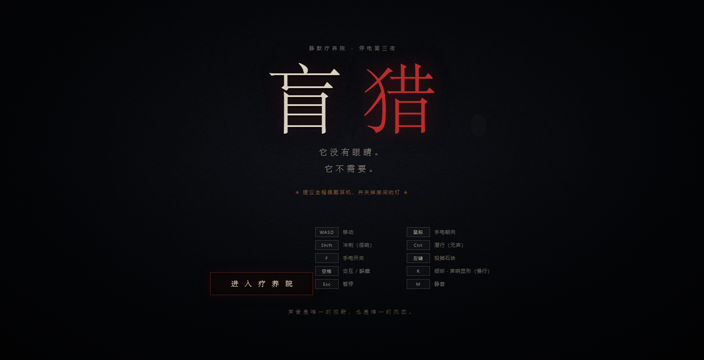
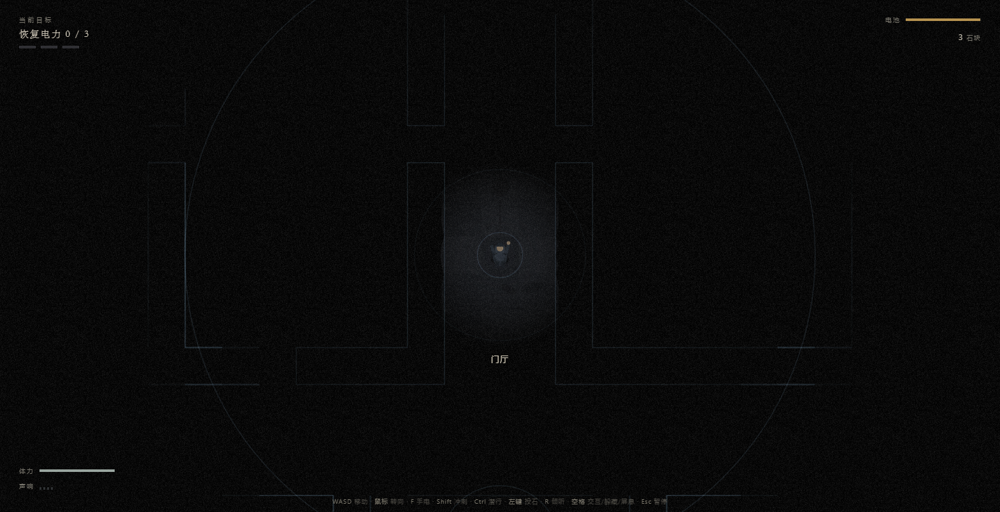
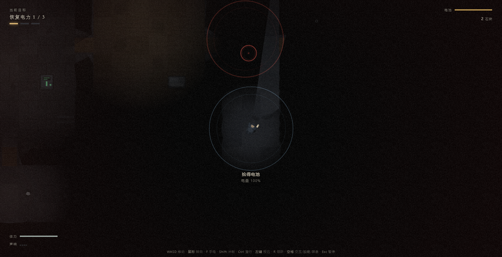
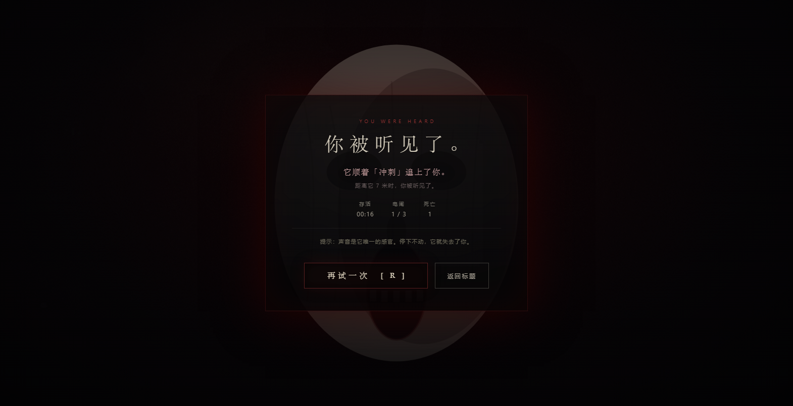
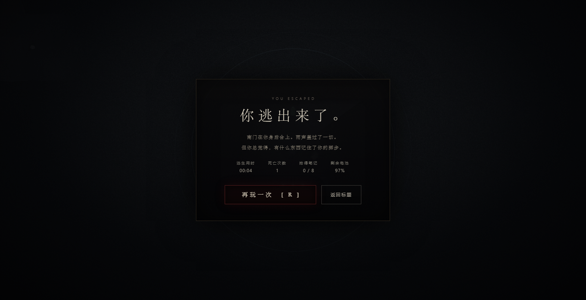

# 盲猎 · Blind Hunt

一款关于「追杀」的浏览器恐怖游戏。你在一座停电的废弃疗养院里恢复三路电力，然后从南门逃出去。
**它没有眼睛。它不需要。** 它靠声音找你——你的脚步、你的喘息、你合闸时的电流声。

> 声音是你唯一的视野，也是你唯一的死因。

**▶ 在线试玩：<https://162-ctrl.github.io/blind-hunt/>** （电脑 + 键鼠，建议戴耳机）



| 按住 R 倾听：声呐勾出墙壁 | 手电锥光里的它 |
|---|---|
|  |  |

| 死亡会告诉你：它听见了什么 | 你逃出来了 |
|---|---|
|  |  |

---

## 快速开始

- **在线玩（推荐发给朋友）**：打开 <https://162-ctrl.github.io/blind-hunt/>，点击「进入疗养院」。
- **离线玩**：双击 `index.html`（推荐 Edge / Chrome 最新版），点击「进入疗养院」。
- 单文件版：运行 `node tools/build-dist.mjs` 生成 `dist/盲猎.html`，一个 HTML 文件就能玩，可直接发微信/邮件。

- 首次点击「进入疗养院」是为了让浏览器允许播放声音（Web Audio 需要用户手势）。
- 建议戴耳机：怪物的「哒、哒」声有左右声像，是判断它在哪边耳朵的唯一方式。
- 无需安装、无需本地服务器、无任何外部资源与网络请求，全部程序化合成。

## 怎么赢

1. 找到并**按住空格 2.6 秒**合上三路电闸（锅炉房 B1、配电室 B2、护士办公室 B3）。合闸会发出传遍整栋楼的巨响。
2. 三路电闸全部合上后，南门（你出生的门厅）解锁。
3. 回到南门，**按住空格 2.8 秒**，逃出去。

提示：每合上一路电闸，它的搜寻时间更长、速度更快。先把退路想好。

## 操作

| 按键 | 作用 |
|---|---|
| `W A S D` | 移动 |
| 鼠标 | 手电指向 / 角色朝向（`F` 开关手电，电池有限） |
| `Shift` | 冲刺（很响，耗体力） |
| `Ctrl` / `C` | 潜行（几乎无声，但慢） |
| `空格` / `E` | 交互（合闸、开门）｜在躲藏点按：躲进去｜躲藏中按住：屏住呼吸（约 3.4 秒上限） |
| 左键 | 投掷石块（诱饵：落地的声音能把它引开） |
| `R` | 倾听：站定不动，**声呐扫过墙壁勾出轮廓**，声音涟漪更清晰 |
| `Esc` | 暂停 |
| `M` | 静音 |

## 它怎么找你

- 怪物完全失明，只对「噪音事件」有反应：走路、冲刺、喘息、合闸、投石、屏息失败的抽气。
- **冲刺**的噪音半径最大；**潜行**几乎无声；**站着不动**它就会失去你。
- 它听到声音后会先 `investigate` 走向声源，靠近后进入 `search`，并**逐个检查附近的躲藏点**。
- 搜索时如果你躲在柜子/床底里**按住空格屏息**，它就找不到你；呼吸断掉的那一瞬，它会掀开你藏身的地方。
- 追逐时若 3.6 秒内没有再次听到你，它会放弃并开始搜索最后听到的位置。**它永远不会瞬移**。

## 美术与音频

- 纯 Canvas 2D 渲染：静态层预渲染 + 动态光照遮罩（环境光 / 手电锥 / 电闸灯 / 闪电），无贴图文件。
- 全部音效由 `js/audio.js` 用 Web Audio 实时合成：心跳随危险度加速、呼吸随体力变化、怪物脚步/点击/尖啸、雷暴与建筑吱嘎、电流嗡鸣随合闸数增加。

## 文件结构

```
index.html          页面骨架、HUD、各类界面、错误捕获
css/style.css       暗色恐怖风 UI
js/level.js         疗养院地图数据（64×45 格，16 房间 + 6 段走廊，30 门、31 躲藏点、3 电闸、8 笔记、14 拾取物）
js/game.js          A* 寻路、听觉系统、怪物状态机、玩家/躲藏/投石/交互、死亡与胜利流程
js/render.js        预渲染静态层、光照遮罩、声呐、涟漪、死亡特写、标题氛围
js/audio.js         程序化 WebAudio 音频引擎（23 种事件 + 心跳/呼吸/压迫/环境层）
js/main.js          输入、HUD、界面切换、主循环、无头测试接口 window.__BH_DEBUG
tests/audio-test.html   音频引擎自测页（无头运行输出 AUDIO_SELFTEST_OK）
tests/cdp-run.mjs       16 阶段无头 E2E（Edge + CDP：启动→手电→声呐→合闸→笔记→拾取→投石→躲藏→追击→暂停→死亡→重开→胜利→零报错）
tests/cdp-shots.mjs     视觉迭代探针（快速截取门厅/声呐/全灯画面）
tests/shots/            验收截图
```

## 开发 / 测试

```bat
D:\node.exe --check js\game.js
D:\node.exe tests\cdp-run.mjs          :: 16 阶段全绿（约 1 分钟；无头软件渲染较慢，脚本按状态轮询）
```

音频自测：

```bat
"C:\Program Files (x86)\Microsoft\Edge\Application\msedge.exe" --headless=new --disable-gpu ^
  --autoplay-policy=no-user-gesture-required --virtual-time-budget=5000 --dump-dom ^
  "file:///D:/万昊林/项目/恐怖游戏/tests/audio-test.html"
```

无头截图调试：`index.html#autostart&sim=30&seed=7` 会自动开局、跑 30 秒模拟并把快照写进 `#errlog`。

## 设计取舍

- **为什么这么黑**：恐怖来自信息饥荒。你能安全看清的东西很少，所以「停下来听」必须真的有用、真的危险。
- **为什么怪物永不瞬移**：恐怖要有因果。死的时候你要能复盘「它听见了什么、在几米外」——死亡界面会直接告诉你。
- **为什么加声呐**：给玩家一个主动获取信息的工具，但代价是站定不动。移动与理解之间必须二选一。
- **为什么死亡能复盘**：死亡不是惩罚，是教学。每次死都告诉你下次该在哪个环节闭嘴。

## 已知限制

- 未适配触屏 / 移动端（需要键盘 + 鼠标）。
- 音频需一次用户手势后才能启动；静音或无声环境下游戏逻辑仍然完整（音频层全为安全 no-op）。
- 无头 E2E 使用软件渲染，帧率约 10–20fps；真实浏览器在有 GPU 时正常。
